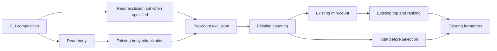

# Architecture Spine — wordfreq 除外指定

## Discussion boundary

PRDの六条件と既存CLIを接続する最小設計原本。製品未決は[PRD Open questions](../prd/prd-wordfreq-exclude.md#open-questions)に残す。OQ-1〜OQ-6は各仕様・期待値確定前、OQ-7は価値評価時、OQ-8は公開・引渡し条件設定時にPM経由で元の担当へ戻す。除外指定時の比較にcasefoldを採用するか、行にstripを適用するか、UTF-8で読むか、不存在以外もexit2にするか、全語除外に専用メッセージを出すかは決めない。initiativeはfrontmatterのみ参照した。独立レビューはdiscussion用途の条件付き合格であり、後続実装の承認を意味しない。

## Design Paradigm

既存の **pipes-and-filters（単方向CLI）** を設計方針として追認する。CLIが入力取得・処理・出力を合成し、集計とformatterはファイル取得を担わない。新サービス・永続データモデル・外部連携は設けない。

## Invariants & Rules

### AD-1 — 集計前の共通除外境界 [ADOPTED]

- **Binds:** FR-1〜FR-4、RULE-1〜RULE-2、入力取得・集計・全formatter。
- **Prevents:** 出力形式ごとの除外差、表示行だけの削除、除外前総数と除外後順位の混在。
- **Rule:** CLI合成境界で除外集合の読取りを統括し、指定時は本文トークンから対象語を除いた後に既存集計へ渡す。除外は全形式共通とし、formatterから除外FILEを読まない。集計後のmin-count→top→既存formatterの順序を維持する。HTML総数は除外後・min-count/top前の出現数合計とする（PRD RULE-1の論理的帰結）。追加依存・権限変更・外部送信を必要としない。

矢印はデータフローとCLIの合成責務を表し、読取りの時間的優先順位は規定しない。I/O・終了判断はCLI側、集計・formatterから入力取得側への依存は持ち込まない。集合の比較規則・行解釈はPRD OQ-1〜OQ-4の解消を待つ。図は既存casefold済みトークンだけをフィルタ入力に固定する契約ではない。OQ-1の回答後、設計担当は合意例を判定できる情報が比較境界に残ることを確認し、必要なら抽出と正規化を分けて図と境界を更新してから実装計画へ渡す。

### AD-2 — 未指定非干渉と残存語の保存 [ADOPTED]

- **Binds:** FR-6、RULE-1、既存引数・本文処理・全出力。
- **Prevents:** オプション追加による旧CLIの読取り・正規化・順位・エラーの変更、除外重複による回数差。
- **Rule:** --exclude未指定では除外FILEの読取り・検証を起動せず、既存の本文分割/casefold、回数降順・同数時の正規化後初出順、min-count→top、書式とエラー契約を維持する。指定時も残存語の回数・相対初出順を変えず、同一有効除外語の重複で結果を変えない。本文不存在の既存exit1を除外FILE不存在のexit2へ置換しない。複合失敗の優先順位はOQ-6に残す。

## Structural Seed — code-owned

現行根拠は `wordfreq/__main__.py`（CLI合成、総数、絞込み、出力）、`sources.py`（本文取得）、`tokenizer.py`（本文抽出とcasefold）、`aggregator.py`（計数と安定順位）、`formatters.py`（text/json/html）、`__init__.py`。現時点では除外オプションはない。これは現行観察であり、新しい配置・関数シグネチャ・型を拘束しない。

運用境界は既存ローカルCLI内。新しいデプロイ先・環境・provider・認証・通信・永続化を導入しない。新技術やversionを指定しない。

## Capability → Architecture Map

| PRD | 接続点 | 拘束／未決 |
| --- | --- | --- |
| FR-1、RULE-1 | CLI合成→集計前フィルタ→既存集計・formatter | AD-1、AD-2。HTML総数も同一境界 |
| FR-2、FR-3 | 除外集合の読取り・比較 | AD-1。空行・先頭#と大文字小文字非区別はPRD、細部はOQ-1〜OQ-4 |
| FR-4 | CLI側の入力失敗通知・終了 | PRDの読める本文＋除外FILE不存在は原因通知とexit2。その他・複合失敗はOQ-3、OQ-6 |
| FR-5 | --help、README、対応試験 | PRD直接検証を後続へ。未決方式を説明で確定しない |
| FR-6 | 未指定の既存CLI全経路 | AD-2。既存試験と未指定互換性の検証は後続 |
| RULE-2 | ローカル実行境界 | AD-1。追加依存・権限変更・外部送信なし |

## Deferred

- モジュール名・関数シグネチャ・集合の具体型・Counter・例外型・内部状態管理・関数分割は既存コード所有／後続実装。ADの境界を守れば本高度で追加schemaは不要。
- 行解釈・Unicode比較・読込契約・複数指定・全語除外案内・異常系優先順位はPRD OQ-1〜OQ-6。製品未決であり実装者の自由裁量ではない。対応する仕様・期待値確定前に解消する。
- help／READMEの具体文面と試験配置はFR-5の直接検証を満たす後続作業。現行本文読込仕様を除外FILEへ自動流用しない。
- デプロイ／環境移行／infra・provider変更／運用基盤・性能数値目標は今回追加なし。公開義務が判明したらOQ-8で再評価。価値評価はOQ-7へ。
