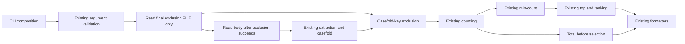

# Architecture Spine — wordfreq 除外指定

## Design Paradigm

既存の **pipes-and-filters（単方向CLI）** を維持する。CLIが入力取得・処理・出力を合成し、集計とformatterはファイル取得を担わない。新サービス・永続化・外部連携は設けない。

旧OQ-1〜6は受付t_c172b029の明示回答（2026-11-28T06:59:36.405633+00:00）、PM判断t_834ece37、差戻しt_14fbf7f0に基づき解決済み。[PRD](../prd/prd-wordfreq-exclude.md)と[決定記録](../decisions-oq1-6.md)を採用する。本書は実装・試験合格や実装着手承認を意味しない。OQ-7/8は背景不足のみで停止条件ではない。

## Invariants & Rules

### AD-1 — 集計前の共通除外境界 [ADOPTED]

- **Binds:** FR-1〜FR-4、RULE-1〜RULE-2、入力取得・集計・全formatter。
- **Prevents:** 形式別の除外差、表示後削除、除外前総数と除外後順位の混在。
- **Rule:** CLI合成境界が除外集合の読取りを統括し、指定時は本文のcasefold済みトークンから一致語を除いて既存集計へ渡す。全形式で除外→計数→min-count→top→既存formatter。HTML総数は除外後・min-count/top前の出現数合計。formatterから除外FILEを読まず、集計・formatterから入力取得側への依存を持ち込まない。追加依存・権限変更・外部送信を必要としない。

図は指定時の成功経路。未指定時はLOADを通らず既存の本文経路へ進む。失敗時はAD-4に従い、後段の読取り・計数・出力を行わない。

### AD-2 — 未指定非干渉と残存語の保存 [ADOPTED]

- **Binds:** FR-6、RULE-1、既存引数・本文処理・全出力。
- **Prevents:** 既存CLIの正規化・順位・エラーの変更、重複による回数差、全語除外の独自出力。
- **Rule:** 未指定では除外FILEの読取り・検証を起動せず、既存本文分割/casefold、回数降順・同数時の正規化後初出順、min-count→top、書式とエラーを維持する。指定時も残存語の回数・相対初出順を変えず、重複有効行は無影響。全語除外は各形式の既存空結果でexit0。text空、JSON `[]\n`、HTML既存空表・既存空結果案内と総数0。除外専用メッセージは追加しない。

### AD-3 — 正規化キーと行解釈の分離 [ADOPTED]

- **Binds:** FR-1〜FR-3、除外読込・tokenizer・比較境界。
- **Prevents:** lowerの導入によるUnicode不一致、本文tokenizer流用による行の分割、追加コメント文法。
- **Rule:** 除外FILEはUTF-8で読み、ファイル先頭BOMを除去する。LF／CRLF／終端改行なしを受け入れる。各行をstrip→空なら無視→先頭#なら行全体無視→全体を一語としてcasefoldする。途中#は文字のままで分割・記号除去しない。本文は既存抽出とcasefoldを維持し、そのキーで集計前比較する。本文STRASSEは除外行Straßeで除く。`foo bar` はfoo/barを個別除外せず、`foo_bar`／`123`／`foo-bar` はそのままの比較キーで、本文に現れないものは無影響。lowerへ変更せず、lower済み値から元表記を復元しない。

比較境界の実読確認：`tokenizer.py:6-18` は `\w+` 抽出後にcasefoldし入力順に返し、`aggregator.py:6-17` はそのキーを計数して同数時の挿入順を保つ。元表記はcasefold時に失われるが採用した同一casefoldキー比較には不要で、Straße／STRASSEはいずれもstrasseとして比較可能。抽出後に失われたハイフン等を除外行から復元・補完しない。

### AD-4 — 最後のFILEと失敗の直列優先順位 [ADOPTED]

- **Binds:** FR-1、FR-4、FR-6、CLI引数解決・読込・終了判断。
- **Prevents:** 前のFILEまで読む実装、複合失敗の順序差、除外失敗時のstdout部分出力、本文exit1の変更。
- **Rule:** 複数 `--exclude` は最後のFILEだけ採用し、それ以前を読まない。既存引数検証（既存help終了を含む）→指定時の除外FILE→本文の順。除外FILEの不存在・権限不足・ディレクトリ・不正文字コードなど読込失敗は対象と原因をstderr、exit2、stdout空とし本文を読まない。文言完全一致は不要。両ファイル失敗でも除外exit2。除外成功後の本文失敗は既存exit1。読込・終了判断はCLI側で統括し、成功までformatter出力を開始しない。

## Structural Seed — code-owned

現行根拠は `wordfreq/__main__.py`（引数検証→本文取得、総数・絞込み・出力）、`sources.py`（本文UTF-8取得とInputError）、`tokenizer.py`（抽出とcasefold）、`aggregator.py`（計数と安定順位）、`formatters.py`（各形式・空結果）。現時点で除外オプションはなく、追加機能は未実装。新たな配置・関数シグネチャ・具体型は拘束しない。

運用は既存ローカルCLI内。新しいデプロイ先・環境・provider・認証・通信・永続化・技術versionを導入しない。現行コードの実読で既存技術の適合を確認し、変更しないversionを新規に固定しない。

## Capability → Architecture Map

| PRD | 接続点 | 拘束 |
| --- | --- | --- |
| PRD参照 FR-1、RULE-1 | CLI→集計前フィルタ→既存集計・全formatter | AD-1・AD-2・AD-4 |
| PRD参照 FR-2、FR-3 | 除外読込とcasefold比較境界 | AD-3。PRDの文字列別期待値を後続試験へ |
| PRD参照 FR-4 | 引数検証・除外取得・本文取得・診断終了 | AD-4。対象／原因、stderr／stdout、exitと順序 |
| PRD参照 FR-5 | help、README、対応試験 | 採用仕様の説明と試験は後続実装。本工程は文書のみ |
| PRD参照 FR-6 | 未指定と全語除外 | AD-2・AD-4。既存試験・新機能試験の合格は未主張 |
| PRD参照 RULE-2 | ローカル実行 | AD-1、既存運用維持 |

## Deferred

- 配置・関数シグネチャ・具体集合型・Counter・例外型・関数分割はコード所有／後続実装。ADの比較キー・行解釈・優先順位を変える裁量は与えない。
- help／READMEの具体文面と試験配置はPRD FR-5と各直接検証を満たす後続作業。ここでは製品／README／試験／GSD計画を変更しない。
- デプロイ／環境移行／infra・provider／運用基盤・性能数値目標は追加なし。OQ-7は価値評価、OQ-8は公開・引渡し条件設定時にPMが再訪する背景不足。現時点の機能受入に追加条件を課さない。
