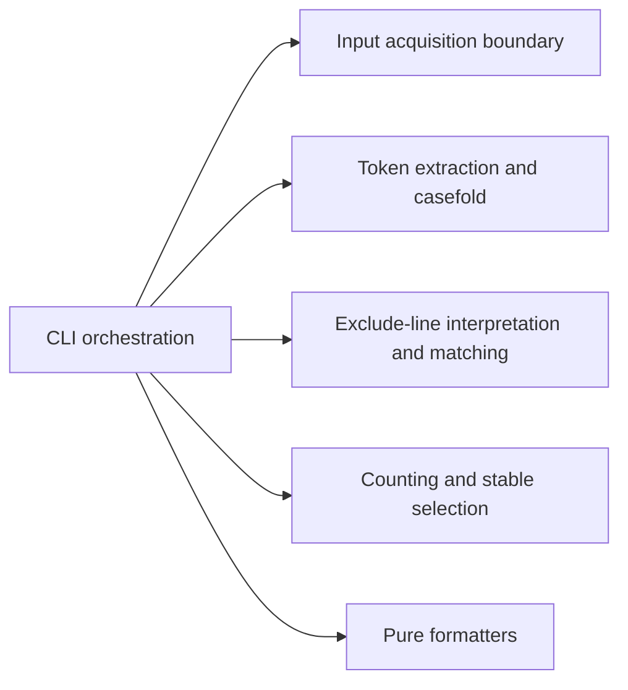
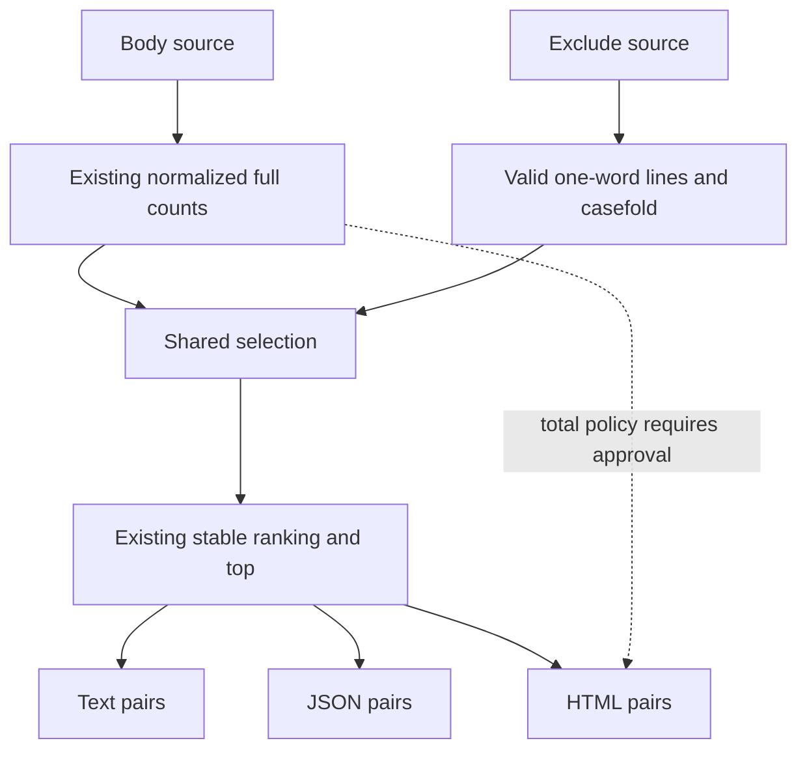

# Architecture Spine — wordfreq-exclude

このspineは承認済みの既存境界を維持する契約であり、製品未決を解決する設計承認ではない。未決は [共通一覧](../open-questions.md)、入力は [PRD](../prd/prd-wordfreq-exclude.md)。

## Design Paradigm

既存の pipes-and-filters を維持する。CLIが取得と純粋処理を合成し、sourcesはファイル取得、tokenizerは抽出/正規化、aggregatorは集計/並び、formattersは表示だけを担う。

矢印は依存可能方向。末端部品からCLIへ依存して終了コードを決めたり、純粋処理からファイルを取得したりしない。

## Invariants & Rules

### AD-1 — [ADOPTED] 取得と純粋処理の分離

- **Binds:** FR-1、FR-2、FR-6、FR-7、入力/集計/整形の境界。
- **Prevents:** 集計・整形がそれぞれ除外FILEを読んで異なる語一覧や失敗処理を持つこと。
- **Rule:** CLIは取得境界で得たテキストを行解釈・照合へ渡す。count_words/top_words/formattersにファイルI/O、argv解析、exit判断を追加しない。新規関数名とファイル分割はBuilderに委ねる。

### AD-2 — [ADOPTED] 同一の正規化と残存語の順序

- **Binds:** FR-1、FR-2、FR-3、FR-5、FR-7、照合と順位。
- **Prevents:** lowerでUnicode照合が割れること、集合の反復順が同数順位へ混入すること。
- **Rule:** 本文は既存Unicode抽出とcasefoldを維持する。有効な1語行もcasefold後に語の同値照合へ使う。除外語の全出現を外し、残った語の回数/初出順を保持する。除外FILEの語順や重複で本文順位は変わらない。空行と生の行頭#は無視するが、trim/字下げ/不正行の未決を独自に埋めない。

### AD-3 — [ADOPTED] 失敗の入力役割を保持

- **Binds:** FR-4、FR-7、CLIと取得境界。
- **Prevents:** 共有InputErrorを本文ハンドラへ流して除外FILE不存在をexit1にすること。
- **Rule:** 取得失敗のcauseと入力の役割をCLIのポリシー判断まで保持する。本文の既存読込み失敗はexit1、本文が有効なときの除外FILE不存在は説明stderr/exit2、結果stdout空でTracebackなし。すべてをFileNotFoundErrorとみなさず、他の除外読込み失敗と同時失敗は共通一覧の回答後に定める。引数検証は既存どおり取得より先。

### AD-4 — [ADOPTED] 表示候補と元集計を混同しない

- **Binds:** FR-5、FR-7、全形式とHTMLメタ情報。
- **Prevents:** 形式別の除外処理、top後の除外、元Counterの破壊による総数の暗黙変更。
- **Rule:** 除外とmin-countを満たす表示候補を既存の回数降順/同数初出順で並べてtopへ渡す。同じ結果pairsを各形式へ渡す。未指定時の全入力CounterとHTML総数契約を維持する。除外指定時のHTML総数は承認待ちであり、元集計を破壊して選択肢を失わせない。総数ポリシーの採用はこのADに含まれない。

## Consistency Conventions

| Concern | Convention |
| --- | --- |
| Shared data | 正規化語と回数、順序は既存Counter/pairs契約に従う。行の解釈と取得失敗ポリシーは全形式共通。 |
| Public surface | 任意の--exclude FILEのみを追加。未指定時の引数/出力/エラー契約は変更しない。 |
| Formatting | text/jsonの引数と形式、HTML UTF-8/escape/basename/静的CSS/空状態を維持。 |
| Operations | 既存ローカルプロセスのみ。新依存・通信・CI変更なし。入力/除外FILEは読取り対象であり書き換えない。 |

## Structural Seed

既存実装とpyproject.tomlを実読して確認した標準ライブラリ構成を継承する。新技術・starter・バージョン固定を採用しないためStack表は追加しない。CIの対象Python版や依存版を本機の版で上書きしない。

状態は実行内だけ。新しいDB・永続設定・認証・provider・deployment環境・サーバー運用はない。実装ファイル構成は既存コードが所有する。

## Deferred

- 製品未決は共通一覧に集約。HTML totalはHTML経路の前、行構文はパーサー前、他の取得失敗はローダー前、同時失敗はCLI結線前に依頼者が回答する。これは下位実装に自由裁量を委ねるDeferredではなく承認ゲート。
- 関数名、補助モジュール、集合型、試験ファイルの配置はBuilderが決める。既存境界と上記不変条件を守れば互換性判断は変わらない。
- docs/helpはPRDの説明要求をそのまま実装し、新しい機能範囲をここでは定義しない。
- 新インフラ、性能SLO、認証、スキーマ移行、デプロイ変更は要求されていないため追加しない。必要になれば別変更として再設計する。

## Assumptions

[ASSUMPTION: purpose/altitude] 単一CLI機能のbuild-substrateとして範囲を推定し、追加の人向けarchitecture renderingは作らない。パーサー、取得失敗、総数の未決があるため draft / partial。未決のままフル実装や受入を承認しない。
