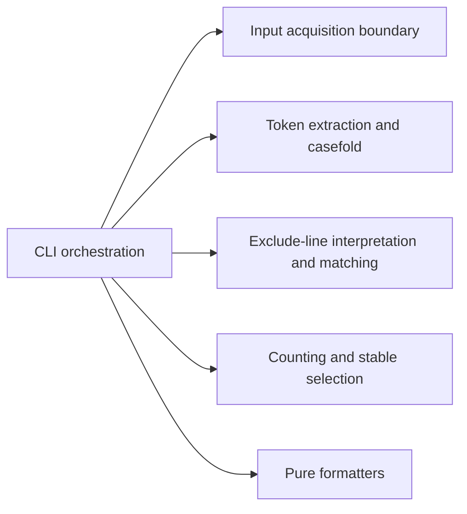
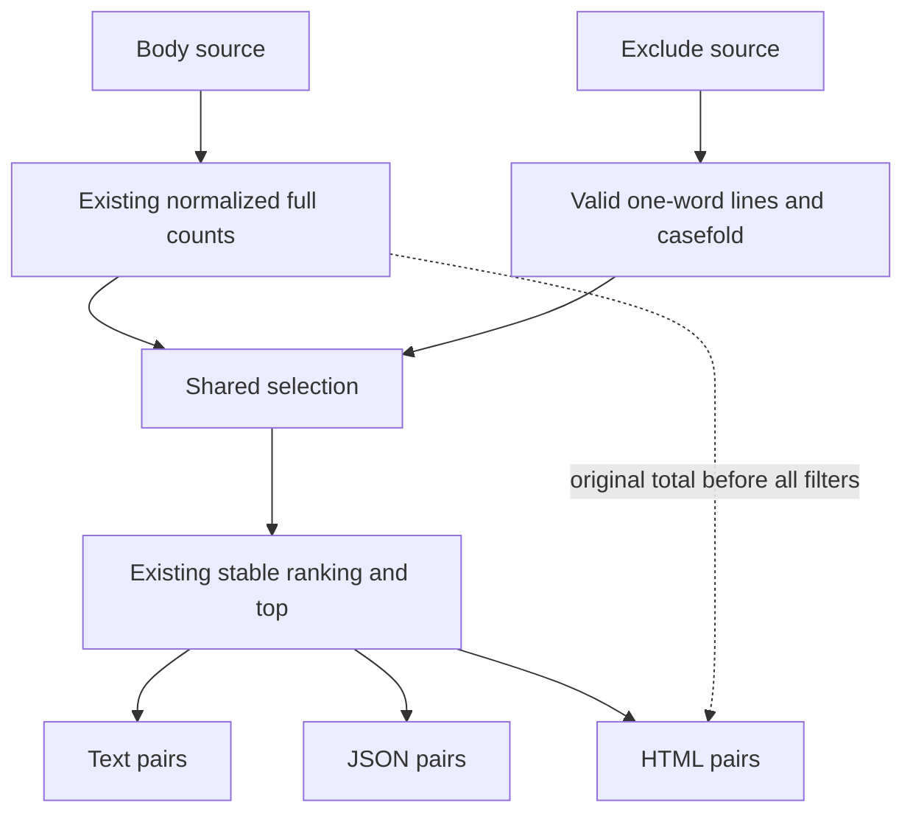

# Architecture Spine — wordfreq-exclude

このspineは既存境界と [採用決定](../decision-update.md) の5件を反映した更新原本である。判断日時は `2026-11-28T14:45:42.849521+00:00`。製品未決は [共通一覧](../open-questions.md) のとおりなし。入力は [PRD](../prd/prd-wordfreq-exclude.md)。reconciliationと公式Reviewer Gateを終えた文書のfinal状態を、後続 t_91b92aed の仕様承認や実装承認とはしない。

## Design Paradigm

既存の pipes-and-filters を維持する。CLIが取得と純粋処理を合成し、sourcesはファイル取得、tokenizerは抽出/正規化、aggregatorは集計/並び、formattersは表示だけを担う。

矢印は依存可能方向。末端部品からCLIへ依存して終了コードを決めたり、純粋処理からファイルを取得したりしない。

## Invariants & Rules

### AD-1 — [ADOPTED] 取得と純粋処理の分離

- **Binds:** FR-1、FR-2、FR-6、FR-7、入力/集計/整形の境界。
- **Prevents:** 集計・整形がそれぞれ除外FILEを読んで異なる語一覧や失敗処理を持つこと。
- **Rule:** CLIは取得境界で得たテキストを行解釈・照合へ渡す。count_words/top_words/formattersにファイルI/O、argv解析、exit判断を追加しない。新規関数名とファイル分割はBuilderに委ねる。

### AD-2 — [ADOPTED] 同一の正規化と残存語の順序

- **Binds:** FR-1、FR-2、FR-3、FR-5、FR-7、照合と順位。
- **Prevents:** lowerでUnicode照合が割れること、集合の反復順が同数順位へ混入すること。
- **Rule:** 本文の既存Unicode抽出とcasefoldは変更しない。除外はLF/CRLF/最終改行なしを受け付け、各行の前後空白を除去してから空行と#開始行を無視する。残る行は既存Unicode `\w+` に行全体が一致する場合だけ受け付け、その後casefoldして照合する。数字/underscoreは可、複数語・句読点・hyphen・単独結合文字・語の後の#注記・先頭BOMは不正行としAD-3に従う。本文同様の部分抽出やBOM除去で受理しない。除外語の全出現をランキングから外し、残る語の回数/初出順を保持する。除外FILEの語順や重複は本文順位を変えない。

### AD-3 — [ADOPTED] 失敗の入力役割を保持

- **Binds:** FR-4、FR-7、CLIと取得境界。
- **Prevents:** 共有InputErrorによる除外失敗のexit1化、本文先行取得による診断と終了コードの競合。
- **Rule:** 取得失敗のcauseと入力の役割をCLIの判断まで保持する。除外FILEはUTF-8。不在・権限不足・ディレクトリ指定・不正文字コードなど全読込み失敗はFILEと理由が分かるstderr/exit2。不正行はファイル名と行番号の分かるstderr/exit2。いずれも結果stdout空、集計結果・HTML・Tracebackなし。既存の引数構文/数値検査→指定された除外FILEの取得と全行検証→本文取得の順を守る。除外に問題があればその説明/exit2で止め、本文は読まない。本文の既存読込み失敗はexit1を維持する。終了コードはCLIのみが決める。

### AD-4 — [ADOPTED] 表示候補と元集計を混同しない

- **Binds:** FR-5、FR-7、全形式とHTMLメタ情報。
- **Prevents:** 形式別の除外処理、top後の除外、元Counterの破壊による総数の暗黙変更。
- **Rule:** 除外対象ではなく、min-countを満たす表示候補を既存の回数降順/同数初出順で並べてtopへ渡す。同じ結果pairsを各形式へ渡す。全入力Counterを破壊せず、HTML総数は除外の有無によらず除外/min-count/top前の元入力全体から取る。全語除外や閾値による0行表示でも総数から除外語を引かない。text/jsonは既存の空結果形式、HTMLは既存の空状態と元総数を維持する。

## Consistency Conventions

| Concern | Convention |
| --- | --- |
| Shared data | 正規化語と回数、順序は既存Counter/pairs契約に従う。行の解釈と取得失敗ポリシーは全形式共通。 |
| Public surface | 任意の--exclude FILEのみを追加。未指定時の引数/出力/エラー契約は変更しない。 |
| Formatting | text/jsonの引数と形式、HTML UTF-8/escape/basename/静的CSS/空状態を維持。 |
| Operations | 既存ローカルプロセスのみ。新依存・通信・CI変更なし。入力/除外FILEは読取り対象であり書き換えない。 |

## Structural Seed

既存実装とpyproject.tomlを実読して確認した標準ライブラリ構成を継承する。新技術・starter・バージョン固定を採用しないためStack表は追加しない。CIの対象Python版や依存版を本機の版で上書きしない。

上図はデータ依存のみを示し、実行順を示さない。取得の順は必ずAD-3の「引数検査→除外取得・全行検証→成功時のみ本文取得」に従う。

状態は実行内だけ。新しいDB・永続設定・認証・provider・deployment環境・サーバー運用はない。実装ファイル構成は既存コードが所有する。

## Deferred

- 過去の5件の製品保留は採用決定により解消済みであり、下位実装の裁量へ委ねない。未解決製品事項は共通一覧にのみ記載する。
- 関数名、補助モジュール、集合型、試験ファイルの配置はBuilderが決める。既存境界と上記不変条件を守れば互換性判断は変わらない。
- docs/helpはPRDの説明要求をそのまま実装し、新しい機能範囲をここでは定義しない。
- 新インフラ、性能SLO、認証、スキーマ移行、デプロイ変更は要求されていないため追加しない。必要になれば別変更として再設計する。

## Assumptions

[ASSUMPTION: purpose/altitude] 単一CLI機能のbuild-substrateとして範囲を推定し、追加の人向けarchitecture renderingは作らない。製品未決は解消済み。背景と文書構成の推定は受入契約を変更せず、後続仕様承認を先取りしない。
